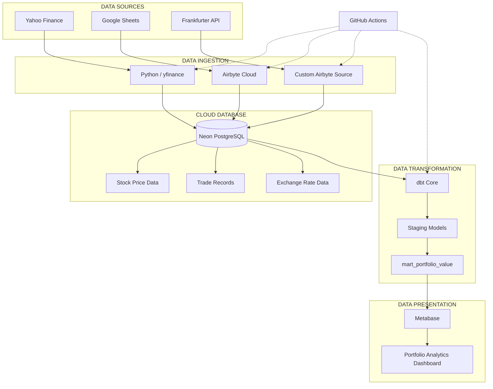

# Data Pipeline Architecture

## 1. Introduction

This document describes the architecture of the Portfolio Analytics Data Engineering Capstone.

The solution integrates three financial data sources, stores the ingested datasets in Neon PostgreSQL, transforms the data using dbt, and presents portfolio performance metrics through Metabase.

GitHub Actions coordinates the automated execution of the pipeline.

## 2. High-Level Architecture

## 3. Architecture Components

### 3.1 Data Sources

The pipeline collects data from three independent sources:

- **Yahoo Finance:** Provides historical daily stock market prices for seven selected companies.
- **Google Sheets:** Contains 500 generated trade transaction records.
- **Frankfurter API:** Provides historical USD/NGN exchange-rate information.

### 3.2 Data Ingestion Layer

The ingestion layer is responsible for extracting data and delivering it to the database.

**Python and yfinance**

Python retrieves historical stock market data using the yfinance library. The extracted dataset is prepared and loaded into Neon PostgreSQL.

**Airbyte Cloud**

Airbyte synchronizes trade transaction data from Google Sheets into PostgreSQL.

**Custom Airbyte Source**

A custom connector implemented in `exchange_rate_source.py` retrieves historical exchange rates from the Frankfurter API and makes them available for ingestion.

### 3.3 Data Storage Layer

Neon PostgreSQL serves as the centralized cloud database.

It stores the datasets required for portfolio analysis:

- Historical stock prices.
- Trade transaction records.
- Historical exchange rates.

The database provides the source data for subsequent transformations.

### 3.4 Data Transformation Layer

dbt Core performs the transformation and modeling operations.

The transformation workflow consists of:

**Staging models**

- `stg_stock_prices`
- `stg_trades`
- `stg_exchange_rates`

These models prepare the ingested datasets for analytical use.

**Analytical mart**

`mart_portfolio_value`

The mart combines the transformed datasets to calculate:

- Shares held.
- Stock cost basis.
- Market value.
- Unrealized gain or loss.
- Portfolio value in USD.
- Portfolio value in NGN.

The resulting model provides the analytical dataset used by the dashboard.

### 3.5 Orchestration Layer

GitHub Actions coordinates the execution of the data pipeline.

The workflow is defined in:

`.github/workflows/daily_pipeline.yml`

It supports scheduled execution from Monday to Friday at 7:00 AM UTC (8:00 AM Nigerian time), as well as manual execution.

The workflow coordinates stock data ingestion, Airbyte synchronization and dbt transformations.

### 3.6 Visualization Layer

Metabase connects to Neon PostgreSQL and presents the transformed portfolio data through an interactive dashboard.

The dashboard includes:

1. Portfolio Value Over Time.
2. Gain/Loss by Position.
3. Current Portfolio Allocation.
4. Portfolio Value in NGN vs USD.

Metabase runs locally through Docker Desktop.

## 4. End-to-End Data Flow

The pipeline operates through the following sequence:

1. Historical stock prices are extracted from Yahoo Finance using Python.
2. Trade transaction records are synchronized from Google Sheets through Airbyte.
3. Historical exchange rates are retrieved through the custom Airbyte source.
4. The datasets are stored in Neon PostgreSQL.
5. dbt staging models prepare the source datasets.
6. The analytical mart calculates portfolio metrics.
7. GitHub Actions coordinates scheduled and manually triggered pipeline execution.
8. Metabase retrieves the analytical results and presents them through dashboard visualizations.

## 5. Architecture Design Decisions

The architecture uses separate tools for ingestion, storage, transformation, orchestration and visualization.

This separation provides modularity and makes individual pipeline components easier to maintain.

- **Python** provides flexibility for extracting and processing stock market data.
- **Airbyte** simplifies the integration of external data sources.
- **Neon PostgreSQL** provides centralized cloud database storage.
- **dbt** separates analytical transformations from data ingestion.
- **GitHub Actions** automates pipeline execution.
- **Metabase** provides an accessible interface for analyzing transformed data.

The architecture also supports future expansion, including additional data sources, portfolio metrics and analytical models.

## 6. Conclusion

The project demonstrates an end-to-end data engineering architecture that integrates multiple data sources into a centralized analytical solution.

By combining Python, Airbyte, PostgreSQL, dbt, GitHub Actions and Metabase, the solution establishes a repeatable workflow for data ingestion, transformation, orchestration and portfolio performance reporting.