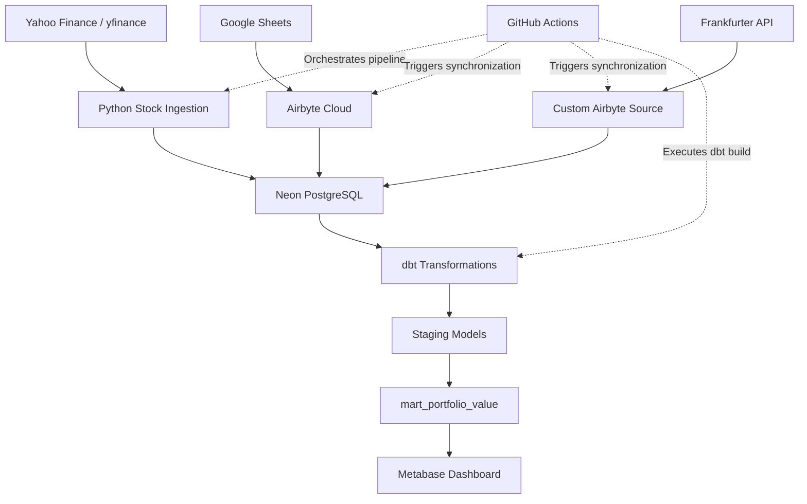

# End-to-End Portfolio Analytics Data Engineering Capstone Project

## 1. Project Overview

The **Portfolio Analytics Data Engineering Pipeline is an end-to-end data engineering project developed as part of the DataFrik Data Engineering Capstone.**

The project demonstrates how multiple financial data sources can be integrated into an automated data pipeline to support portfolio performance analysis.

It combines historical stock market prices, trade transaction records and foreign exchange rates into a centralized PostgreSQL database. The data is subsequently transformed using dbt (Data Build Tool) and presented through an interactive Metabase dashboard.

The solution covers the major stages of a modern data engineering workflow: data extraction, ingestion, storage, transformation, orchestration and visualization.

## 2. Project Objectives

The primary objectives are to:

- Build an automated pipeline for collecting historical stock market data.
- Integrate trade transaction records from Google Sheets.
- Ingest historical USD/NGN exchange rates through a custom Airbyte source.
- Store data in a centralized PostgreSQL database.
- Develop modular data transformation models using dbt.
- Calculate portfolio value, cost basis, market value and unrealized gains or losses.
- Convert portfolio valuation from USD to NGN.
- Automate pipeline execution using GitHub Actions.
- Develop an analytical dashboard for monitoring portfolio performance.

## 3. Technology Stack

| Technology      | Application                             |
| --------------- | --------------------------------------- |
| Python 3.12     | Data extraction and ingestion           |
| yfinance        | Historical stock market data            |
| Google Sheets   | Trade transaction data source           |
| Airbyte Cloud   | Data integration and synchronization    |
| Frankfurter API | Historical USD/NGN exchange rates       |
| Neon PostgreSQL | Cloud database and data warehouse       |
| SQL             | Data querying and transformation        |
| SQLAlchemy      | Python database connectivity            |
| dbt Core        | Data transformation and testing         |
| GitHub Actions  | Pipeline orchestration and scheduling   |
| Docker          | Local Metabase deployment               |
| Metabase        | Business intelligence and visualization |
| GitHub          | Version control and project hosting     |

## 4. Data Sources

The pipeline integrates three primary data sources.

### 4.1 Stock Market Data

Historical daily stock market data is extracted using the `yfinance` Python library.

The initial historical dataset covers seven publicly traded companies:

| Ticker | Company   |
| ------ | --------- |
| AAPL   | Apple     |
| GOOGL  | Alphabet  |
| MSFT   | Microsoft |
| AMZN   | Amazon    |
| TSLA   | Tesla     |
| NVDA   | NVIDIA    |
| NFLX   | Netflix   |

The initial extraction retrieved one year of daily historical stock price data, producing 1,757 records across the seven tickers.

The dataset is stored in PostgreSQL for downstream transformation and analysis.

### 4.2 Trade Transaction Data

Trade transaction data is maintained in Google Sheets and synchronized into Neon PostgreSQL using Airbyte Cloud.

The dataset contains 500 generated trade records with the following fields:

- Trade date
- Stock ticker
- Number of shares purchased
- Purchase price per share in USD

These records provide the transaction history used to calculate portfolio holdings and investment costs.

**Note:** The trade records are synthetic data created for this capstone project. They are used to demonstrate the integration and analysis of portfolio transactions.

### 4.3 Foreign Exchange Data

Historical USD/NGN exchange rates are retrieved from the Frankfurter API.

A custom Airbyte source connector, implemented in `exchange_rate_source.py`, is used to integrate exchange-rate data into the pipeline.

The exchange-rate dataset supports the conversion of portfolio valuations from US dollars to Nigerian naira.

## 5. Project Architecture

The solution follows a multi-source data ingestion and transformation architecture.



### Pipeline Workflow

1. Python extracts historical stock prices from Yahoo Finance using yfinance.
2. Stock price data is loaded into Neon PostgreSQL.
3. Airbyte Cloud synchronizes trade transaction records from Google Sheets.
4. A custom Airbyte source retrieves USD/NGN exchange-rate data from Frankfurter.
5. The ingested datasets are stored in PostgreSQL.
6. dbt transforms the raw datasets into structured staging models.
7. The analytical mart calculates portfolio holdings, valuation and performance metrics.
8. GitHub Actions coordinates scheduled and manually triggered pipeline executions.
9. Metabase connects to the analytical database to visualize the resulting data.

## 6. Database Design and Transformation

Neon PostgreSQL serves as the centralized database for the project.

The database separates ingested data from transformed analytical data.

### 6.1 Staging Models

The following dbt staging models prepare the source datasets for analysis:

| Model                | Description                           |
| -------------------- | ------------------------------------- |
| `stg_stock_prices`   | Prepares historical stock market data |
| `stg_trades`         | Prepares trade transaction records    |
| `stg_exchange_rates` | Prepares foreign exchange data        |

These models provide a consistent structure for downstream analytical transformations.

### 6.2 Analytical Mart

The central analytical model is:

`mart_portfolio_value`

This model combines the transformed stock price, trade and exchange-rate datasets to calculate portfolio performance.

The resulting dataset includes:

| Column                     | Description                          |
| -------------------------- | ------------------------------------ |
| `price_date`               | Stock valuation date                 |
| `ticker`                   | Stock ticker symbol                  |
| `shares_held`              | Number of shares held                |
| `closing_price_usd`        | Closing stock price in USD           |
| `cost_basis_usd`           | Investment cost basis in USD         |
| `market_value_usd`         | Current market value of the position |
| `unrealized_gain_loss_usd` | Unrealized profit or loss            |
| `portfolio_value_usd`      | Total portfolio value in USD         |
| `usd_ngn_rate`             | USD/NGN exchange rate                |
| `portfolio_value_ngn`      | Total portfolio value in NGN         |

### 6.3 Key Calculations

**Market Value**

The market value of an individual stock position is calculated as:

`Market Value = Shares Held × Closing Price`

**Cost Basis**

The cost basis represents the total purchase cost of the shares held.

**Unrealized Gain or Loss**

`Unrealized Gain/Loss = Market Value − Cost Basis`

**Portfolio Value in NGN**

`Portfolio Value (NGN) = Portfolio Value (USD) × USD/NGN Exchange Rate`

These metrics provide a basis for monitoring portfolio performance across different valuation dates.

**Data grain:** The portfolio mart contains stock-level records by valuation date. Portfolio-level totals are repeated across the ticker records for each date. Therefore, portfolio totals should be aggregated using `MAX` rather than `SUM` when querying this mart.

## 7. Data Quality and Testing

Data quality checks are incorporated into the ingestion and transformation workflow.

The initial stock price dataset was checked for:

- Missing values
- Duplicate records
- Data consistency
- Successful database loading

dbt tests are used to validate the transformed models and help identify data quality issues during pipeline execution.

The pipeline uses `dbt build` to execute model transformations and associated tests.

## 8. Pipeline Orchestration and Automation

GitHub Actions is used to automate pipeline execution.

The workflow is defined in:

`.github/workflows/daily_pipeline.yml`

The workflow supports:

- Scheduled execution from Monday to Friday at 8:00 AM West Africa Time (WAT).
- Manual execution through the GitHub Actions interface.
- Stock market data ingestion.
- Airbyte synchronization.
- dbt model execution and testing.

The scheduled execution uses the GitHub Actions cron expression:

`0 7 * * 1-5`

This represents 7:00 AM UTC, equivalent to 8:00 AM in Nigeria.

The pipeline was manually triggered and successfully executed as an end-to-end workflow.

## 9. Data Visualization and Dashboard

Metabase is used to develop an interactive portfolio analytics dashboard.

The dashboard connects to the analytical data in Neon PostgreSQL and presents the following visualizations:

| Visualization                 | Chart Type | Purpose                                            |
| ----------------------------- | ---------- | -------------------------------------------------- |
| Portfolio Value Over Time     | Line chart | Tracks portfolio valuation across dates            |
| Gain/Loss by Position         | Bar chart  | Compares unrealized gains and losses across stocks |
| Current Portfolio Allocation  | Pie chart  | Shows the distribution of portfolio value by stock |
| Portfolio Value in NGN vs USD | Line chart | Compares portfolio valuation in two currencies     |

Metabase is deployed locally using Docker, while Neon PostgreSQL provides the cloud-hosted analytical database.


## 10. Project Setup and Execution

### Prerequisites

To reproduce the project, the following are required:

- Python 3.12 or later
- Git
- Neon PostgreSQL account
- Airbyte Cloud account
- Docker Desktop
- dbt Core with the PostgreSQL adapter

### Step 1: Clone the Repository

```bash
git clone https://github.com/Ayomhi1234/DATAFRIK_CAPSTONE_PROJECT.git
```

### Step 2: Navigate to the Project Directory

```bash
cd DATAFRIK_CAPSTONE_PROJECT
```

### Step 3: Create a Virtual Environment

```bash
python -m venv .venv
```

Activate it on Windows PowerShell:

```powershell
.venv\Scripts\Activate.ps1
```

### Step 4: Install Dependencies

Install the required Python packages and dbt PostgreSQL adapter:

```bash
pip install yfinance pandas python-dotenv SQLAlchemy psycopg2-binary dbt-postgres
```

Install any additional dependencies required by the custom Airbyte connector in its execution environment.

### Step 5: Configure Environment Variables

Create a local `.env` file and configure the required database connection details.

Do not commit the `.env` file or expose database credentials in the repository.

### Step 6: Run Stock Price Ingestion

```bash
python INGESTION/stock_prices.py
```

### Step 7: Configure Data Synchronization

Configure the Google Sheets and custom exchange-rate source connections in Airbyte Cloud, including their destinations in Neon PostgreSQL.

### Step 8: Run dbt Transformations

From the project root:

```bash
dbt build --project-dir ./portfolio_analytics
```

### Step 9: Access the Dashboard

Start the local Metabase Docker container and visit:

`http://localhost:3000`

Connect Metabase to the Neon PostgreSQL database and access the saved portfolio analytics dashboard.

**Note:** The setup instructions describe the main reproduction workflow. Airbyte Cloud connections, credentials and GitHub Actions secrets must also be configured for a complete automated deployment.

## 11. Key Project Outcomes

The project demonstrates the practical application of data engineering concepts through:

- Multi-source data ingestion.
- API-based data extraction.
- Custom connector development.
- Cloud database integration.
- Data transformation and modeling with dbt.
- Data quality testing.
- Automated workflow orchestration.
- Analytical reporting and visualization.

It also demonstrates how financial data from multiple sources can be integrated into a structured analytical solution for portfolio monitoring.

##
